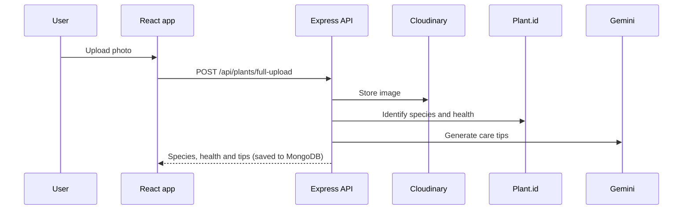

<div align="center">

# 🌿 Rutika AI: Plant Health Analyzer

**Snap a photo of a plant to identify the species, check its health and get personalised care tips.**


### [🌐 Live demo](https://rutika-ai.vercel.app)

</div>

---

## ✨ Features

- **Upload a plant photo**, stored on **Cloudinary**
- **Species identification and health assessment** with the **[Plant.id API](https://plant.id)**
- **AI care tips** (watering, light, treatment) generated by **Google Gemini** (`gemini-2.0-flash`)
- A **plant details page** with the analysis results
- Every analysis is **saved to MongoDB**
- Animated UI with Framer Motion and Lottie, and toast notifications

## 🏗️ How it works



## 📡 API

| Method | Endpoint | Description |
|:---:|---|---|
| `POST` | `/api/plants/full-upload` | `multipart/form-data` with field `image`. Uploads, identifies, generates care tips and saves the result |

## 🚀 Run locally

```bash
git clone https://github.com/mayurvij22/Rutika-Ai.git
cd Rutika-Ai
```

`backend/.env`:

```env
PORT=5000
MONGO_URI=your_mongodb_uri
CLOUDINARY_CLOUD_NAME=...
CLOUDINARY_API_KEY=...
CLOUDINARY_API_SECRET=...
PLANT_ID_API_KEY=...
GEMINI_API_KEY=...
```

```bash
cd backend && npm install && npm run dev
cd ../frontend && npm install && npm run dev
```

## 🛠️ Tech stack

| Layer | Technology |
|---|---|
| Frontend | React, Vite, Tailwind CSS, Framer Motion, Lottie, React Router |
| Backend | Node.js, Express, Multer + Cloudinary storage, Mongoose |
| AI and vision | Plant.id API, Google Gemini |
| Hosting | Vercel |

---

<div align="center">

Made by **[Mayur Patil](https://github.com/mayurvij22)**

</div>
